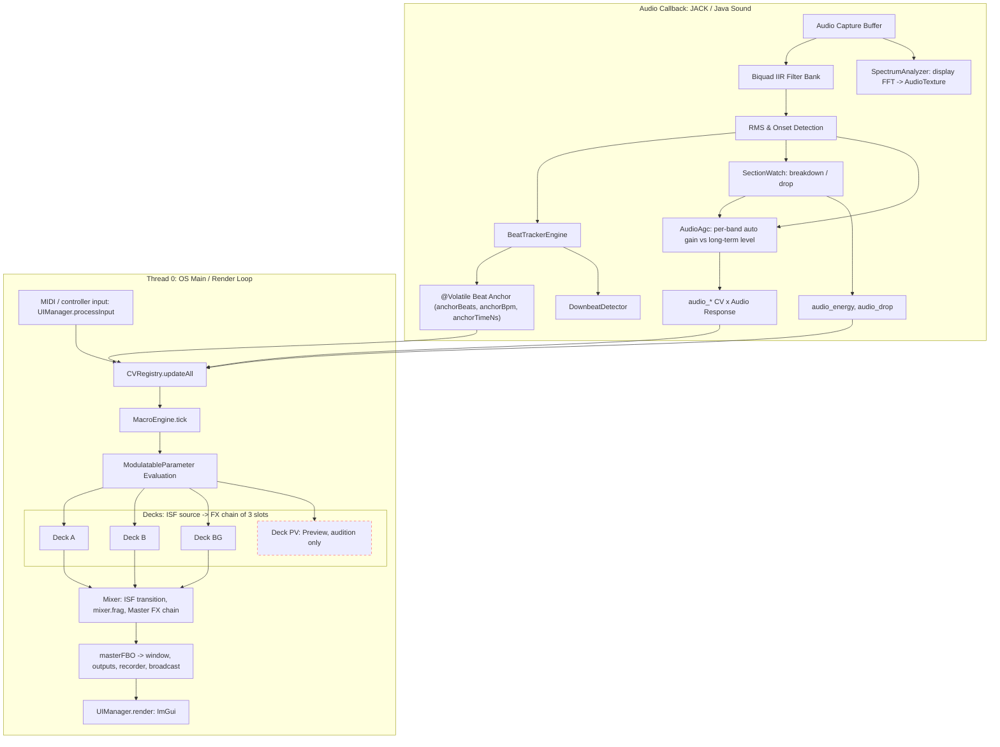

# Architecture Overview

This section covers high-level system design, threading boundaries, concurrency models, and notes persistence in **Liquid LSD**.

---

## High-Level Video & Data Pipeline

`ARCHITECTURE.md` at the repository root is the verified map of the code (frame loop, threads, ownership). This page keeps the overview.

---

## Threading Boundaries

Thread 0 (the OS main thread) owns GLFW, every OpenGL call, ImGui and the whole frame loop; the audio callback owns DSP. Several daemon threads (MIDI receiver, OSC receiver, preset I/O, library scanners, recorder, broadcast, controller feedback writers) never touch GL and hand their work to Thread 0 through queues. The full thread table is `ARCHITECTURE.md` §1.

### 1. Thread 0 (OS Main & Rendering Thread)
- **Responsibilities**: GLFW event polling, MIDI/OSC/controller dispatch, OpenGL context management, framebuffer allocation, GLSL shader compilation/binding, frame rendering (Decks A/B/BG/PV, Mixer), and ImGui UI rendering.
- **Strict Constraint**: All LWJGL 3 GLFW window and OpenGL context manipulations must execute strictly on Thread 0.

### 2. Audio Thread (JACK Callback / Java Sound Capture Thread)
- **Responsibilities**: Receives incoming audio sample buffers, executes parallel biquad IIR bandpass filtering (Bass, Mid, Hi-Mid, High), computes RMS amplitude, detects each band's hits (`TransientDetector`), and updates beat clock state. It also runs the always-on auto gain (`AudioAgc`), the song-section watch (`SectionWatch`, which freezes the AGC's long-term level in breakdowns and feeds `audio_energy` / `audio_drop`), `DownbeatDetector` and the display spectrum (`SpectrumAnalyzer`), all allocation-free. Details: [audio_dsp.md](audio_dsp.md).
- **Strict Real-Time Constraints**:
  - **Zero-Allocation Rule**: No heap allocations (`new`, capturing closures, collection instantiations) inside the audio callback loop.
  - **Non-Blocking Rule**: No mutex locks, file I/O, database access, logging, or thread sleeping.

---

## Concurrency Safety & Lock-Free Data Passing

Because the audio processing loop runs at sub-millisecond hardware intervals (~50–200 Hz) while Thread 0 renders frames at screen refresh rates (60Hz–144Hz+), lock-free synchronization prevents audio dropouts (xruns) and frame stuttering.

### Concurrency Primitives
- **`@Volatile` Beat Anchor Fields**: Lock-free update passing `anchorBeats`, `anchorBpm`, and `anchorTimeNs` directly from the audio thread to `CVRegistry.updateBeatAnchor()` using primitive `@Volatile` fields. Zero object allocations occur on the audio callback thread. Thread 0 reads these volatile variables without locks and interpolates sub-millisecond phase accuracy via `CVRegistry.getSynchronizedTotalBeats()`.
- **`CvHistoryBuffer`**: Pre-allocated ring buffer storing 200 CV samples for lock-free oscilloscope drawing in the Modulation column (`PropertiesPanel`).
- **`@Volatile` Flags**: Thread-safe single-scalar flags (`isBpmLocked`, `manualBpm`, `inputGain`) accessed across threads without lock overhead.
- **Concurrent Queues**: `ConcurrentLinkedQueue`s carry finished deck, FX and transition loads (`DeckOps`, `FxOps`, `TransitionOps`, drained at the start of the render phase), incoming MIDI events (`MidiEngine`, capped, drained by `UIManager.processInput` before the render phase), and incoming OSC messages decoded on the dedicated UDP receiver thread (`OscEngine.inboundQueue`), all drained on Thread 0 once per frame.

---

## Notes System Persistence Architecture

Liquid LSD integrates a three-tier notes persistence model managed by `NotesManager.kt`:

| Note Scope | Storage Target | Lifetime | API Method |
|------------|----------------|----------|------------|
| **Global Source Notes** | `~/.liquid-lsd/source-notes.json` | App-global; survives preset changes | `NotesManager.getSourceNote / setSourceNote` |
| **Preset Notes** | `.lsd` JSON (`presetNotes`) | Saved/loaded per preset file | `NotesManager.getPresetNote / setPresetNote` |
| **Parameter Notes** | `.lsd` JSON (`paramNotes`) | Saved/loaded per preset file | `NotesManager.getParamNote / setParamNote` |

`PresetManager` automatically syncs in-memory notes with `.lsd` DTOs during async load (`syncFromDto`) and save (`syncToDto`) operations.

---

## Video I/O & External GPU Texture Streaming Architecture

Liquid LSD provides low-latency, zero-copy (or DMA-BUF/MemFD) live video sharing to external VJ software (Resolume Arena, OBS Studio, TouchDesigner, MadMapper):

- **Platform Drivers**:
  - **Windows**: Spout2 2.007.017 through `SpoutApi`. SpoutLibrary.dll exports only `GetSpout()`, a C++ object; every call goes through its vtable with the object as the first argument. Slots follow MSVC's layout (overloads grouped at the first one, last declared first), checked against the DLL's own vtable; `SpoutApiTest` checks dispatch with a fake object. A new DLL needs the slots checked again. Senders invert (GL bottom-up to Spout's top-down) as the SDK does by default; receivers follow the 2.007 loop (receive, and reallocate on `IsUpdated`).
  - **macOS**: Syphon through `SyphonBridge`: `objc_msgSend` invoked with fixed signatures (variadic calls are wrong on Apple Silicon) and NSRect/NSSize by value; servers and clients are created on the current CGL context with `initWithName:context:options:` / `initWithServerDescription:context:options:newFrameHandler:`; received frames are GL_TEXTURE_RECTANGLE, blitted into an own 2D texture before the SyphonImage is released. Description keys are read from the framework's exported constants. The release build ships the universal framework from the `syphon-natives` tag.
  - **Linux**: PipeWire 0.3 video bridge (`rendering/pipewire/`).

### PipeWire Video (format negotiation and frame handoff)
- **Formats (`SpaPod`)**: the SPA pod builder is header-only C, so `SpaPod` writes the few pods a raw video stream needs by hand (EnumFormat, Buffers) and parses the agreed Format. Constants come from PipeWire 1.6's headers; `SpaPodTest` checks the layout. Field offsets in `pw_buffer`/`spa_buffer`/`spa_data`/`spa_chunk` are in `SpaBufferLayout`.
- **Output (`PipeWireBridge`)**: a `Video/Source` stream with `PW_STREAM_FLAG_DRIVER`, offering RGBA at the stream size. `param_changed(Format)` answers with a Buffers param (size, stride). Thread 0 deposits the latest PBO readback in `pendingFrame` (no lock, no copy); a `Dispatchers.IO` worker copies it, rows flipped into top-to-bottom order, into a dequeued buffer, sets the chunk, queues it and calls `pw_stream_trigger_process`, with the thread loop locked. `LinuxTextureBridge` attaches the endpoint's texture to its own read FBO (reading FBO 0 would capture the window) and reconnects when the size changes.
- **Ingest (`PipeWireReceiverImpl`)**: offers RGBA/BGRA/RGBx/BGRx/YUY2/GRAY8 at any size and rate (PipeWire doesn't convert video formats). YUY2 is uploaded packed (one RGBA texel per two pixels) and converted BT.601 limited-range to RGBA in a one-pass shader into its own FBO, with the caller's framebuffer, program, viewport and blend restored; GRAY8 is an R8 texture swizzled to grey, learns the agreed size and order in `param_changed`, takes the newest queued buffer on Thread 0 and uploads it row by row into mirrored positions (video rows run top to bottom), with alpha forced opaque for x formats. `target.object` is the node name `ExternalVideoDiscovery` mapped from the label in the browser; nodes sharing a description get ` (2)`, ` (3)` labels.
- **Lab check**: `.planning/auto-verify-2026-11-06/round5/` runs the app against a private PipeWire with GStreamer on both ends.
